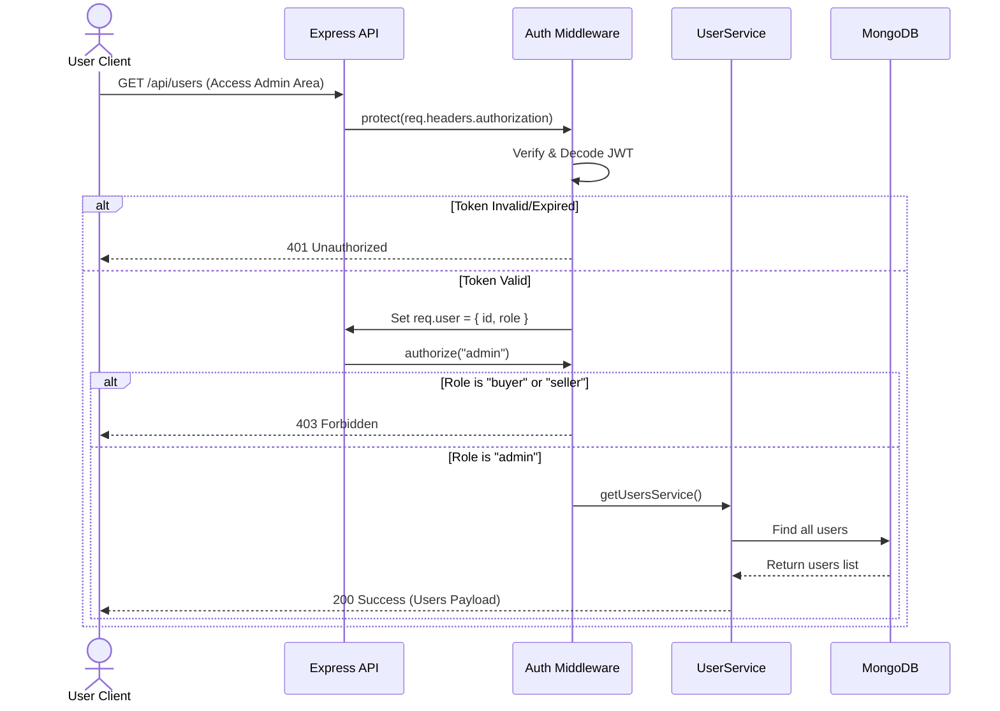
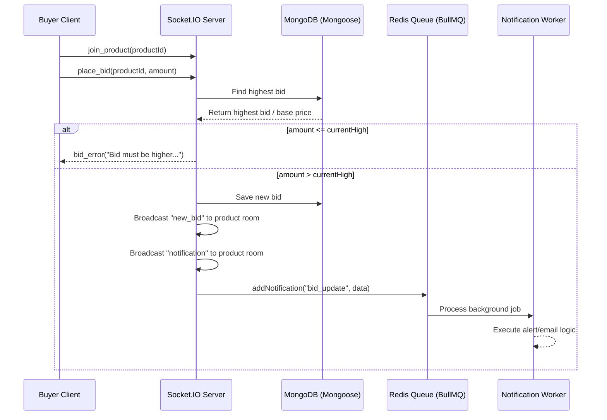
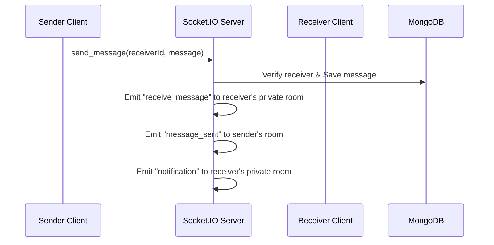
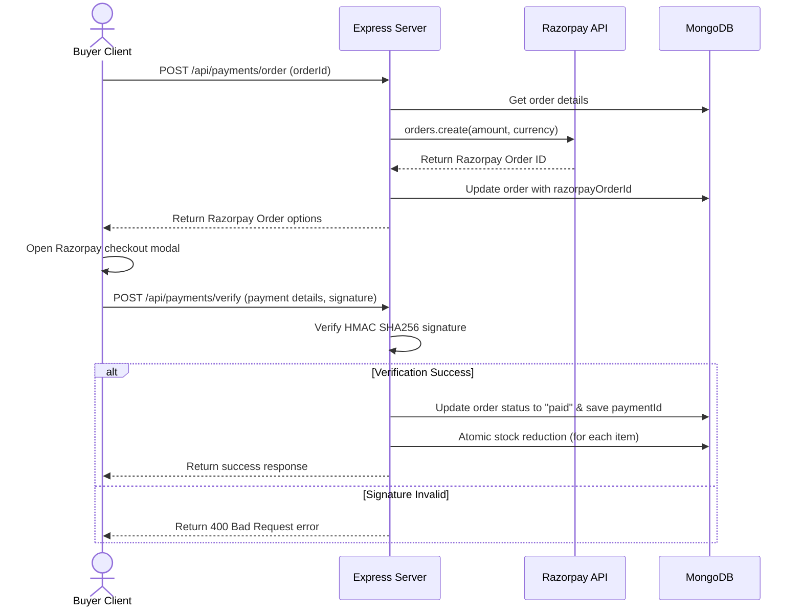

# 🏗️ Document 3: System Architecture Design (SAD)

## 1. High-Level Architecture Pattern

The Sustainable Local Marketplace utilizes a modern decoupled **Client-Server Architecture** featuring a single-page React client communicating with a Node.js/Express REST and WebSocket backend.

```
                  ┌──────────────────────┐
                  │      React SPA       │
                  │   (Vite Frontend)    │
                  └──────────┬───────────┘
                             │
            HTTPS Rest API   │   WebSockets (Socket.io)
            ┌────────────────┴────────────────┐
            ▼                                 ▼
┌────────────────────────────────────────────────────────┐
│                      Express API                       │
│                   (Backend Server)                     │
│                                                        │
│   ┌──────────────┐   ┌──────────────┐   ┌──────────┐   │
│   │ Controllers  │──►│   Services   │──►│ Repos    │   │
│   └──────────────┘   └──────────────┘   └────┬─────┘   │
└──────────────────────────────────────────────┼─────────┘
                                               │
                                       ┌───────┴───────┐
                                       ▼               ▼
                                ┌────────────┐   ┌───────────┐
                                │  MongoDB   │   │   Redis   │
                                └────────────┘   └───────────┘
```

The backend code is organized according to a strict **Service-Repository Pattern**:
1. **Routing Layer**: Receives HTTP requests, executes global rate limiters, input validation middleware, and auth guards.
2. **Controller Layer**: Extracts request parameters (body, query, headers), coordinates basic response formatting, and forwards actions to the Service layer.
3. **Service Layer**: Implements business rules, performs permission/ownership validations, updates sustainability metrics, and coordinates repository calls.
4. **Repository Layer**: Coordinates Mongoose schema queries. Direct database commands are confined strictly to this layer.
5. **Database / Cache Model**: Decouples MongoDB data persistent structures from Redis transient cache states.

---

## 2. Component Directory Structure

The workspace is organized into separate client and server root packages:

```
e:\Susainable\
├── backend/
│   ├── src/
│   │   ├── config/         # DB, Redis, and global credentials
│   │   ├── middleware/     # Auth, error, cache, and rate-limiting
│   │   ├── models/         # MongoDB Mongoose schemas
│   │   ├── modules/        # Modulized routes, controllers, services, repos
│   │   │   ├── auth/
│   │   │   ├── product/
│   │   │   ├── user/
│   │   │   ├── review/
│   │   │   └── order/
│   │   ├── socket/         # Socket.io connection handlers and rooms
│   │   ├── workers/        # BullMQ background notification processors
│   │   ├── app.js          # App configuration
│   │   └── server.js       # HTTP and WebSocket listener
│   └── tests/              # Jest and HTTP test scripts
├── frontend/
│   ├── src/
│   │   ├── assets/         # Images and SVG icons
│   │   ├── shared/         # Reusable layouts, context, hooks
│   │   │   ├── components/ # Canvas leaf graphics, cards
│   │   │   └── state/      # Zustand stores (auth, cart)
│   │   ├── modules/        # Pages and routes
│   │   │   ├── auth/       # Login/Register views
│   │   │   ├── dashboard/  # Seller widgets
│   │   │   ├── home/       # Hero section and bento grid
│   │   │   └── products/   # Catalog details
│   │   └── Router.jsx      # Navigation guards
```

---

## 3. Core System Sequence Flows

### 3.1 Authentication & RBAC Guard Flow


### 3.2 Real-Time Bidding Flow (WebSockets)


### 3.3 Real-Time Chat (WebSockets)


### 3.4 Razorpay Payment & Atomic Stock Reduction Loop


---

## 4. Resilience Strategy (Redis Fail-Soft Fallbacks)

To prevent server crashes and keep the platform functional in environments where Redis may be unavailable (e.g. local developer machine without Docker, or server network disruption), the backend implements a **fail-soft strategy**:

1. **Caching Fallback**: The `cache.middleware.js` catches Redis errors. If the Redis server connection status is not `'ready'`, caching is skipped, and the controller queries MongoDB directly.
2. **WebSocket Scaling Fallback**: If Redis connection fails, the Socket.io initialization handles the error and switches to the default in-memory Adapter instead of crashing the process on the `redis-adapter`.
3. **Queue Fallback**: BullMQ queues are configured with `lazyConnect: true`. If Redis connection drops, notification job creations are logged and skipped rather than blocking core checkouts.
