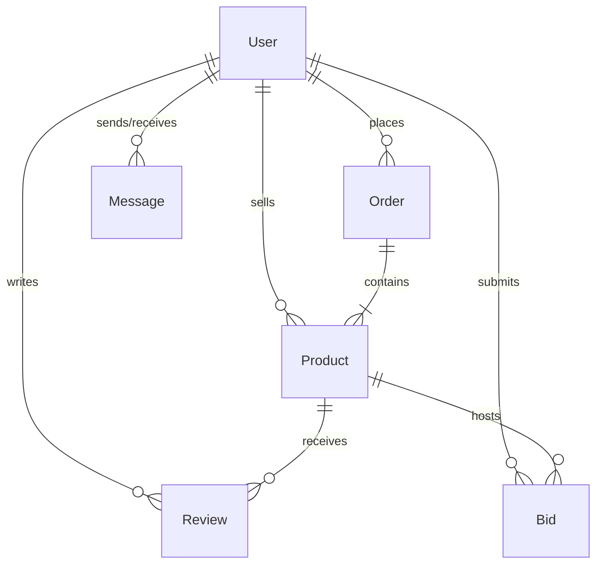

# 💾 Document 4: Database Design Document (DDD)

## 1. Overview
The Sustainable Local Marketplace uses a hybrid database and caching model. The source of truth for persistent data is **MongoDB** (accessed via Mongoose Object Data Modeling). Direct querying latency is reduced using a **Redis** caching layer.

```
                  ┌──────────────────────┐
                  │    Express Server    │
                  └──────────┬───────────┘
                             │
            ┌────────────────┴────────────────┐
            ▼ (Read Cache / Sync PubSub)      ▼ (Write Persistent Data)
      ┌───────────┐                     ┌───────────┐
      │   Redis   │                     │  MongoDB  │
      │  (Cache)  │                     │ (Db Core) │
      └───────────┘                     └───────────┘
```

---

## 2. Collection Schemas (MongoDB)

### 2.1 User Collection (`users`)
Stores user identity, credentials, and RBAC groups.
- **`_id`**: `ObjectId` (Primary Key)
- **`name`**: `String` (Required, trim)
- **`email`**: `String` (Required, unique, lowercase, regex-validated)
- **`password`**: `String` (Required, bcrypt-hashed)
- **`role`**: `String` (Enum: `["buyer", "seller", "admin"]`, default: `"buyer"`)
- **`createdAt`**: `Date` (Automated timestamp)
- **`updatedAt`**: `Date` (Automated timestamp)

### 2.2 Product Collection (`products`)
Stores product parameters including sustainability scoring.
- **`_id`**: `ObjectId` (Primary Key)
- **`title`**: `String` (Required, minimum 3 chars)
- **`description`**: `String` (Required, minimum 10 chars)
- **`price`**: `Number` (Required, minimum 0.01)
- **`sellerId`**: `ObjectId` (Required, Reference to `User` collection)
- **`category`**: `String` (Default: `"general"`)
- **`stock`**: `Number` (Default: `0`, minimum 0)
- **`images`**: `Array[String]` (URLs of uploaded product images)
- **`sustainabilityScore`**: `Number` (Scale: `0-10`, default `0`)
- **`averageRating`**: `Number` (Scale: `0-5`, default `0`)
- **`totalReviews`**: `Number` (Default: `0`)
- **`createdAt`**: `Date` (Automated timestamp)
- **`updatedAt`**: `Date` (Automated timestamp)

### 2.3 Review Collection (`reviews`)
Stores reviews posted by buyers on products.
- **`_id`**: `ObjectId` (Primary Key)
- **`productId`**: `ObjectId` (Required, Reference to `Product` collection)
- **`userId`**: `ObjectId` (Required, Reference to `User` collection)
- **`rating`**: `Number` (Required, Range: `1-5`)
- **`comment`**: `String` (Required, trim)
- **`createdAt`**: `Date` (Automated timestamp)

### 2.4 Order Collection (`orders`)
Stores payment status and transactional items.
- **`_id`**: `ObjectId` (Primary Key)
- **`buyerId`**: `ObjectId` (Required, Reference to `User` collection)
- **`items`**: `Array` containing:
  - **`productId`**: `ObjectId` (Reference to `Product` collection)
  - **`quantity`**: `Number` (Required)
  - **`price`**: `Number` (Required)
- **`totalAmount`**: `Number` (Required)
- **`status`**: `String` (Enum: `["pending", "paid", "shipped"]`, default: `"pending"`)
- **`paymentId`**: `String` (Razorpay payment ID reference)
- **`razorpayOrderId`**: `String` (Razorpay order ID reference)
- **`createdAt`**: `Date` (Automated timestamp)

### 2.5 Message Collection (`messages`)
Stores persistent chat strings for direct messaging.
- **`_id`**: `ObjectId` (Primary Key)
- **`senderId`**: `ObjectId` (Required, Reference to `User` collection)
- **`receiverId`**: `ObjectId` (Required, Reference to `User` collection)
- **`content`**: `String` (Required)
- **`createdAt`**: `Date` (Automated timestamp)

### 2.6 Bid Collection (`bids`)
Stores live auction history.
- **`_id`**: `ObjectId` (Primary Key)
- **`productId`**: `ObjectId` (Required, Reference to `Product` collection)
- **`bidderId`**: `ObjectId` (Required, Reference to `User` collection)
- **`amount`**: `Number` (Required)
- **`createdAt`**: `Date` (Automated timestamp)

---

## 3. Entity-Relationship Diagram (ERD)



---

## 4. Indexing Strategy

To guarantee rapid queries under production loads, the following indexes are applied:

1. **`users`**:
   - Unique Index: `{ email: 1 }` (Enforces login lookups and uniqueness constraint).
2. **`products`**:
   - Single Index: `{ sellerId: 1 }` (Accelerates seller dashboard product queries).
   - Compound Index: `{ category: 1, price: 1 }` (Supports catalog filters).
   - Compound Index: `{ category: 1, sustainabilityScore: -1 }` (Accelerates green filters).
3. **`reviews`**:
   - Single Index: `{ productId: 1 }` (Speeds up loading reviews on the product detail page).
4. **`messages`**:
   - Compound Index: `{ senderId: 1, receiverId: 1, createdAt: -1 }` (Speeds up loading chat history threads).
5. **`bids`**:
   - Compound Index: `{ productId: 1, amount: -1 }` (Speeds up retrieving the highest bid).

---

## 5. Redis Caching Architecture

Redis operates in two contexts: **GET Route Caching** and **WebSocket Pub/Sub**.

### 5.1 Caching Keys & Structures
1. **Product Details**:
   - **Key**: `product:detail:<productId>`
   - **Type**: `String` (JSON stringified product document)
   - **TTL**: `300 seconds` (5 minutes)
2. **Paginated Product Listing**:
   - **Key**: `product:list:<category>:<minPrice>:<maxPrice>:<page>:<limit>`
   - **Type**: `String` (JSON stringified array of products and pagination metadata)
   - **TTL**: `300 seconds`

### 5.2 Cache Invalidation Lifecycle
To prevent serving stale data, the backend repository hook triggers invalidations:
- When a product is **created**, all keys matching `product:list:*` are deleted using the Redis `keys` or scan command.
- When a product is **updated** or **deleted**:
  - The specific `product:detail:<productId>` is deleted.
  - All keys matching `product:list:*` are deleted.
