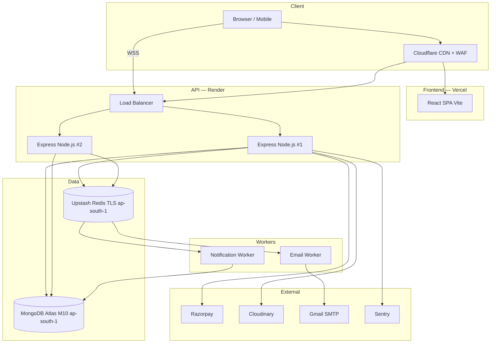

# 🌿 Sustainable Local Marketplace — Master Implementation Specification

**Version**: 1.0 | **Date**: 2026-10-20 | **Status**: PRODUCTION-READY

> This document is the single source of truth. A team can build and deploy the entire system from this document alone.

---

## Assumptions

| Area | Decision |
|---|---|
| Auth storage | JWT in `localStorage`. Accept XSS risk via strict CSP. |
| Backend hosting | **Render** (not AWS) — simpler zero-config deployment. |
| Image hosting | **Cloudinary** — signed uploads for security. |
| Email | **Nodemailer + Gmail SMTP** for MVP. |
| Review eligibility | Only buyers with a `delivered` order containing the product. |
| Auction close | Sellers manually close by setting `isAuction: false`. Auto-timer = Phase 2. |
| Currency | INR only. Razorpay amounts in paise (×100). |
| DPDP | Digital Personal Data Protection Act 2023 (India) — applicable. |

---

# DOMAIN 1: BACKEND — Complete Feature Coverage

## 1.1 Module Directory Structure

```
backend/src/
├── config/
│   ├── db.js           # Mongoose connection
│   ├── redis.js        # ioredis (lazyConnect, error handlers)
│   ├── bullmq.js       # Queue + worker init
│   └── cloudinary.js   # Cloudinary SDK
├── middleware/
│   ├── auth.middleware.js       # protect() + authorize()
│   ├── cache.middleware.js      # Redis GET cache (fail-soft)
│   ├── rateLimit.middleware.js  # Global + auth limiters
│   ├── validate.middleware.js   # Zod schema validator
│   ├── upload.middleware.js     # Multer + Cloudinary stream
│   └── error.middleware.js      # Global error handler
├── modules/
│   ├── auth/           { routes, controller, service, repository, validation }
│   ├── user/           { routes, controller, service, repository, validation }
│   ├── product/        { routes, controller, service, repository, validation }
│   ├── review/         { routes, controller, service, repository, validation }
│   ├── order/          { routes, controller, service, repository, validation }
│   ├── payment/        { routes, controller, service }
│   ├── chat/           { routes, controller, service, repository }
│   ├── bid/            { routes (read-only), controller, repository }
│   ├── notification/   { routes, controller, repository }
│   └── admin/          { routes, controller, service }
├── models/
│   ├── User.model.js
│   ├── Product.model.js
│   ├── Review.model.js
│   ├── Order.model.js
│   ├── Message.model.js
│   ├── Bid.model.js
│   └── Notification.model.js    # NEW collection
├── socket/
│   ├── socket.js          # io init + JWT handshake auth
│   ├── bidding.socket.js  # join_product, place_bid, auction:close
│   └── chat.socket.js     # send_message, typing, online status
├── workers/
│   ├── notification.worker.js  # bid_update, order_status, new_message
│   └── email.worker.js         # welcome, order_confirm, payment_receipt
├── utils/
│   ├── asyncHandler.js    # try/catch wrapper
│   ├── apiResponse.js     # Standard success/error formatters
│   ├── slugify.js
│   └── paise.js           # INR to paise (amount * 100)
├── app.js                 # Express + middleware + routes + CORS + Helmet
└── server.js              # HTTP + Socket.io listener
```

## 1.2 Standard Response Envelopes

**Success**:
```json
{
  "success": true,
  "data": {},
  "message": "Optional",
  "pagination": { "page": 1, "limit": 10, "total": 45, "pages": 5 }
}
```

**Error**:
```json
{
  "success": false,
  "error": {
    "code": "VALIDATION_ERROR",
    "message": "Human-readable message",
    "fields": [{ "field": "email", "message": "Invalid email format" }]
  }
}
```

## 1.3 HTTP Status Code Reference

| Code | When |
|---|---|
| 200 | Successful GET, PUT, DELETE |
| 201 | Successful POST (resource created) |
| 204 | DELETE with no body |
| 400 | Bad request / Zod validation failure |
| 401 | Missing or invalid JWT |
| 403 | Valid JWT but insufficient role |
| 404 | Resource not found |
| 409 | Conflict (duplicate email, already reviewed) |
| 422 | Business logic violation (bid too low, no stock) |
| 429 | Rate limit exceeded |
| 500 | Unhandled server error |

## 1.4 Complete REST API Specification

### AUTH

#### POST /api/auth/register
- **Access**: Public | **Rate limit**: Auth limiter
- **Body**: `{ name: min2, email: regex, password: min8+upper+num+special, role: "buyer"|"seller" }`
- **Response 201**: `{ success, token, data: { id, name, email, role } }`
- **Response 409**: Email already registered

#### POST /api/auth/login
- **Access**: Public | **Rate limit**: Auth limiter
- **Body**: `{ email, password }`
- **Response 200**: `{ success, token, data: { id, name, email, role } }`
- **Response 401**: Invalid credentials (generic — do not specify which field)

#### POST /api/auth/logout
- **Access**: Protected
- **Logic**: Adds token to Redis blacklist with TTL = remaining token lifetime
- **Response 200**: `{ success, message: "Logged out" }`

---

### USER

#### GET /api/users/me
- **Access**: Protected (any role)
- **Response 200**: User object (no password)

#### PUT /api/users/me ← **PREVIOUSLY MISSING**
- **Access**: Protected (any role)
- **Body** (all optional):
  ```json
  {
    "name": "string",
    "avatarUrl": "https://res.cloudinary.com/...",
    "bio": "max 500 chars",
    "location": "Kochi, Kerala",
    "phone": "+91-9876543210",
    "sellerProfile": { "shopName": "string", "shopDescription": "string" }
  }
  ```
- **Validation**: avatarUrl must be Cloudinary URL. `sellerProfile` ignored if role = buyer.
- **Response 200**: Updated user object

#### GET /api/users (Admin only)
- **Query**: `?page&limit&search&role`
- **Response 200**: Paginated user list

#### PUT /api/admin/users/:id/status ← **PREVIOUSLY MISSING**
- **Access**: Admin
- **Body**: `{ "isActive": false, "reason": "string" }`
- **Logic**: Suspended users get 401 on next request (protect middleware checks isActive)
- **Response 200**: Updated user

---

### PRODUCT

#### GET /api/products
- **Access**: Public (Redis cached 300s)
- **Query**:
  - `category`, `minPrice`, `maxPrice`, `minScore` (0-10), `isAuction`
  - `sellerId` ← **PREVIOUSLY MISSING** (ObjectId, for seller dashboard)
  - `search` (full-text on title+description+tags)
  - `page` (default 1), `limit` (default 12, max 50)
  - `sort`: `price_asc | price_desc | score_desc | newest`
- **Response 200**: Paginated product list

#### GET /api/products/:id
- **Access**: Public (Redis cached 300s)
- **Response 200**: Full product with `sustainabilitySubscores`, `isAuction`, `currentBid`, `auctionEndsAt`

#### POST /api/products
- **Access**: Seller only
- **Body**:
  ```json
  {
    "title": "min 3 chars",
    "description": "min 10 chars",
    "price": 299,
    "category": "home",
    "stock": 50,
    "images": ["https://res.cloudinary.com/..."],
    "sustainabilityScore": 9.0,
    "sustainabilitySubscores": { "sourcing": 9, "packaging": 8, "carbon": 10, "water": 9 },
    "tags": ["bamboo", "zero-waste"],
    "isAuction": false,
    "auctionEndsAt": null,
    "auctionStartBid": null
  }
  ```
- **Logic**: Auto-generate `slug`. Set `isApproved: false` (admin must approve). Set `sellerId = req.user.id`.
- **Response 201**: Created product

#### PUT /api/products/:id
- **Access**: Seller (owner) or Admin. 403 if not owner.
- **Logic**: Clear Redis cache on update.

#### DELETE /api/products/:id
- **Access**: Seller (owner) or Admin
- **Logic**: Soft delete (`isActive: false`) if orders exist. Hard delete otherwise.

#### PUT /api/admin/products/:id/status ← **PREVIOUSLY MISSING**
- **Access**: Admin
- **Body**: `{ "isApproved": true }` or `{ "isApproved": false, "rejectionReason": "string" }`
- **Response 200**: Updated product

---

### REVIEW

#### POST /api/reviews
- **Access**: Buyer only
- **Body**: `{ productId, rating: 1-5, comment: min10, images: [] }`
- **Logic**:
  1. Verify buyer has `delivered` order containing `productId` → 403 if not
  2. Check no duplicate review → 409 if exists
  3. Save with `isVerifiedPurchase: true`
  4. Atomically recalculate `averageRating` + `totalReviews` on product
- **Response 201**: Review object

#### GET /api/reviews/product/:productId
- **Access**: Public
- **Query**: `?page&limit&sort=newest`
- **Response 200**: Paginated reviews

#### PUT /api/reviews/:id/seller-reply
- **Access**: Seller (product owner only)
- **Body**: `{ "reply": "string max 1000 chars" }`
- **Response 200**: Updated review

---

### ORDER

#### POST /api/orders
- **Access**: Buyer only
- **Body**:
  ```json
  {
    "items": [{ "productId": "...", "quantity": 2, "price": 299 }],
    "totalAmount": 598,
    "deliveryAddress": {
      "street": "12 MG Road",
      "city": "Bengaluru",
      "state": "Karnataka",
      "pincode": "560001",
      "country": "India"
    }
  }
  ```
- **Logic**: Server recalculates `totalAmount` from DB (client price untrusted). Verify stock. Do NOT deduct stock yet.
- **Response 201**: `{ success, data: { _id, status: "pending", totalAmount } }`

#### GET /api/orders/my ← **PREVIOUSLY MISSING**
- **Access**: Buyer only
- **Query**: `?page&limit&status`
- **Response 200**: Paginated buyer's own orders

#### GET /api/orders/:id
- **Access**: Buyer (own) or Seller (their product in order) or Admin
- **Response 200**: Full order with product details

#### GET /api/orders/seller ← **PREVIOUSLY MISSING**
- **Access**: Seller only
- **Query**: `?page&limit&status`
- **Logic**: Find orders where `items.sellerId = req.user.id`. Project only seller's items.
- **Response 200**: Paginated seller orders with revenue

#### PUT /api/orders/:id/status
- **Access**: Seller (paid→shipped→delivered only) or Admin (any)
- **Body**: `{ "status": "shipped", "trackingNumber": "IND123456789" }`
- **Logic**: Record `shippedAt`/`deliveredAt`. Enqueue notification.
- **Response 200**: Updated order

#### GET /api/admin/orders
- **Access**: Admin
- **Query**: `?page&limit&status&buyerId&sellerId`

---

### PAYMENT

#### POST /api/payments/create
- **Access**: Buyer (own order)
- **Body**: `{ "orderId": "..." }`
- **Logic**:
  1. Verify `buyerId = req.user.id` and `status = 'pending'`
  2. Server recalculates amount from DB (never trust client)
  3. Call Razorpay: `orders.create({ amount: totalAmount * 100, currency: "INR", receipt: orderId })`
  4. Store `razorpayOrderId` on order
- **Response 200**: Razorpay order options

#### POST /api/payments/verify
- **Access**: Buyer
- **Body**: `{ razorpay_order_id, razorpay_payment_id, razorpay_signature, orderId }`
- **Logic**:
  1. `hmac = HMAC_SHA256(razorpay_order_id + "|" + razorpay_payment_id, RAZORPAY_KEY_SECRET)`
  2. Use `crypto.timingSafeEqual()` for comparison
  3. On match: `status → "paid"`, store `paymentId`, `paidAt`
  4. Atomic stock deduction per item (`$inc` with `$gte` guard)
  5. Enqueue: order confirm email, seller new-order notification
- **Response 200**: `{ success, order: { _id, status: "paid" } }`
- **Response 400**: Signature mismatch

---

### CHAT

#### GET /api/messages/threads ← **PREVIOUSLY MISSING**
- **Access**: Protected
- **Logic**: MongoDB aggregation to find unique conversation partners, last message, unread count
- **Response 200**: `[{ partner: UserObject, lastMessage, unreadCount }]`

#### GET /api/messages/:userId ← **PREVIOUSLY MISSING**
- **Access**: Protected
- **Query**: `?page&limit` (default 30, oldest first)
- **Logic**: Messages where `(sender=me AND receiver=userId) OR (sender=userId AND receiver=me)`. Mark as read on fetch.
- **Response 200**: Paginated message history

---

### NOTIFICATION

#### GET /api/notifications
- **Access**: Protected
- **Query**: `?page&limit&isRead`

#### PUT /api/notifications/:id/read
- **Access**: Protected (own notification)

#### PUT /api/notifications/read-all
- **Access**: Protected

---

### ADMIN

#### GET /api/admin/metrics ← **PREVIOUSLY MISSING**
- **Access**: Admin
- **Response 200**:
  ```json
  {
    "users": { "total": 245, "buyers": 200, "sellers": 44, "newThisMonth": 28 },
    "products": { "total": 320, "approved": 290, "pending": 30 },
    "orders": { "total": 1200, "pending": 45, "paid": 800, "shipped": 250, "delivered": 105 },
    "revenue": { "totalINR": 2450000, "thisMonthINR": 185000 },
    "activeAuctions": 12
  }
  ```

#### GET /api/admin/products
- **Access**: Admin
- **Query**: `?page&limit&isApproved&search`

---

### BID

#### GET /api/bids/product/:productId
- **Access**: Public
- **Query**: `?limit=10`
- **Response 200**: Recent bid history for auction UI

---

## 1.5 Socket.io Event Taxonomy

### Authentication (JWT in Handshake)
```javascript
// Server — reject unauthenticated connections
io.use((socket, next) => {
  const token = socket.handshake.auth.token;
  if (!token) return next(new Error('Authentication required'));
  try {
    socket.user = jwt.verify(token, process.env.JWT_SECRET);
    next();
  } catch { next(new Error('Invalid token')); }
});

// Client (SocketProvider.jsx)
const socket = io(VITE_SOCKET_URL, {
  auth: { token: localStorage.getItem('token') },
  reconnection: true,
  reconnectionAttempts: 5,
  reconnectionDelay: 1000
});
```

### Room Naming
| Room | Pattern |
|---|---|
| User private room | `user_${userId}` |
| Product auction room | `product_${productId}` |

### Complete Event Registry

| Direction | Event | Payload | Description |
|---|---|---|---|
| C → S | `join_product` | `productId` | Join auction room |
| C → S | `leave_product` | `productId` | Leave auction room |
| C → S | `place_bid` | `{ productId, amount }` | Submit bid |
| C → S | `send_message` | `{ receiverId, content }` | Send DM |
| C → S | `typing_start` | `{ receiverId }` | Typing indicator |
| C → S | `typing_stop` | `{ receiverId }` | Stop typing |
| S → C | `new_bid` | `BidDocument` | Valid bid broadcast to product room |
| S → C | `bid_error` | `{ message }` | Rejected bid (bidder only) |
| S → C | `auction_closed` | `{ productId, winner }` | Auction ended |
| S → C | `receive_message` | `MessageDocument` | DM received |
| S → C | `message_sent` | `MessageDocument` | DM echo to sender |
| S → C | `user_typing` | `{ senderId }` | Show typing indicator |
| S → C | `user_stop_typing` | `{ senderId }` | Hide typing |
| S → C | `notification` | `NotificationDocument` | Push notification |
| S → C | `user_online` | `{ userId }` | User connected |
| S → C | `user_offline` | `{ userId }` | User disconnected |

## 1.6 BullMQ Background Jobs

### Queue Definitions
```javascript
// notification.queue: bid_update, order_status, new_message, new_order, auction_closed
// email.queue: welcome, order_confirm, payment_receipt, bid_won, bid_outbid

const defaultJobOptions = {
  attempts: 3,
  backoff: { type: 'exponential', delay: 2000 },
  removeOnComplete: 100,
  removeOnFail: 500
};

// Fail-soft: if Redis down, skip job creation — never throw
try {
  await emailQueue.add('order_confirm', data, defaultJobOptions);
} catch (err) {
  logger.warn('BullMQ unavailable', { err: err.message });
}
```

---

# DOMAIN 2: FRONTEND — Screen & Component Specification

## 2.1 Route Structure

```javascript
// All module pages lazy-loaded
const LandingPage = lazy(() => import('./modules/home/LandingPage'));
// ... etc

// Route guards:
// GuestRoute: redirects authenticated users to home
// ProtectedRoute: redirects to /login if no token
// SellerRoute: role === 'seller' guard
// AdminRoute: role === 'admin' guard
```

## 2.2 Screen Catalog

| Screen | Route | Guard | Key API Calls | Mobile Notes |
|---|---|---|---|---|
| Landing | `/` | Public | GET /products (featured), GET /products?isAuction=true | Reduce Three.js particles to 15 |
| Product Catalog | `/products` | Public | GET /products | Filter as bottom sheet |
| Product Detail | `/products/:id` | Public | GET /products/:id, GET /reviews/product/:id | Image carousel, sticky AuctionBar |
| Cart | `/cart` | Protected | Client state only | Cart as bottom sheet |
| Checkout | `/checkout` | Protected | POST /orders | Single-column form |
| Payment | `/payment/:orderId` | Protected | POST /payments/create | Large Razorpay button |
| Payment Success | `/payment/success` | Protected | POST /payments/verify | Confetti animation |
| Payment Failure | `/payment/failure` | Protected | — | Retry + contact CTA |
| My Orders | `/orders` | Protected | GET /orders/my | Card list view |
| Order Detail | `/orders/:id` | Protected | GET /orders/:id | Timeline view |
| Chat Threads | `/messages` | Protected | GET /messages/threads | Full-screen on mobile |
| Chat Thread | `/messages/:userId` | Protected | GET /messages/:userId + socket | Full-screen on mobile |
| Notifications | `/notifications` | Protected | GET /notifications | Swipe to mark read |
| Profile | `/profile` | Protected | GET /users/me, PUT /users/me | Stack layout |
| Login | `/login` | Guest | POST /auth/login | — |
| Register | `/register` | Guest | POST /auth/register | Role selector chips |
| Seller Dashboard | `/dashboard` | Seller | GET /orders/seller (limit 5) | Metric cards grid |
| Seller Products | `/dashboard/products` | Seller | GET /products?sellerId=me | Swipeable table |
| Add Product | `/dashboard/products/new` | Seller | POST /products, Cloudinary | Stacked form |
| Edit Product | `/dashboard/products/:id/edit` | Seller | GET /products/:id, PUT | — |
| Seller Orders | `/dashboard/orders` | Seller | GET /orders/seller | Status dropdown |
| Analytics | `/dashboard/analytics` | Seller | GET /orders/seller | Scrollable charts |
| Admin Dashboard | `/admin` | Admin | GET /admin/metrics | Stats grid |
| Admin Users | `/admin/users` | Admin | GET /users, PUT /admin/users/:id/status | Horizontal scroll table |
| Admin Products | `/admin/products` | Admin | GET /admin/products, PUT /admin/products/:id/status | Approve/Reject CTA |
| Admin Orders | `/admin/orders` | Admin | GET /admin/orders | Date range filter |
| Admin Moderation | `/admin/moderation` | Admin | GET /admin/products?isApproved=false | Priority queue view |
| About | `/about` | Public | — | — |
| How It Works | `/how-it-works` | Public | — | Tab/accordion |
| 404 | `*` | Public | — | Search bar |

## 2.3 Design System Tokens

### Colors
```css
:root {
  /* Emerald Primary */
  --primary-50:  #ecfdf5; --primary-100: #d1fae5; --primary-200: #a7f3d0;
  --primary-300: #6ee7b7; --primary-400: #34d399; --primary-500: #10b981;
  --primary-600: #059669; --primary-700: #047857; --primary-800: #065f46;
  --primary-900: #064e3b;

  /* Neutral Zinc/Slate */
  --surface-50: #f8fafc;  --surface-100: #f1f5f9; --surface-200: #e2e8f0;
  --surface-300: #cbd5e1; --surface-400: #94a3b8; --surface-500: #64748b;
  --surface-600: #475569; --surface-700: #334155; --surface-800: #1e293b;
  --surface-900: #0f172a; --surface-950: #0a0f0d;

  /* Semantic */
  --success: #10b981; --warning: #f59e0b; --danger: #ef4444; --info: #3b82f6;

  /* Light theme */
  --bg-page: var(--surface-50);  --bg-card: #ffffff;
  --text-primary: var(--surface-900); --text-secondary: var(--surface-600);
  --text-muted: var(--surface-500);   /* Min AA contrast — NOT surface-400 */
  --border: var(--surface-200);       --border-focus: var(--primary-500);
}
.dark {
  --bg-page: var(--surface-950); --bg-card: var(--surface-800);
  --text-primary: #f8fafc;       --text-secondary: var(--surface-300);
  --text-muted: var(--surface-500);  --border: rgba(255,255,255,0.08);
  --border-focus: var(--primary-400);
}
```

### Typography
```css
/* Google Fonts */
@import url('https://fonts.googleapis.com/css2?family=Outfit:wght@300;400;500;600;700;800&family=JetBrains+Mono:wght@400;500&display=swap');

:root {
  --font-sans: 'Outfit', ui-sans-serif, system-ui, -apple-system, sans-serif;
  --font-mono: 'JetBrains Mono', ui-monospace, monospace;

  --text-xs: 0.75rem;  --text-sm: 0.875rem; --text-base: 1rem;
  --text-lg: 1.125rem; --text-xl: 1.25rem;  --text-2xl: 1.5rem;
  --text-3xl: 1.875rem;--text-4xl: 2.25rem; --text-5xl: 3rem;
  --text-6xl: 3.75rem;
}
```

### Glassmorphism Utilities
```css
.glass {
  background: rgba(255,255,255,0.75);
  backdrop-filter: blur(16px);
  -webkit-backdrop-filter: blur(16px);
  border: 1px solid rgba(255,255,255,0.6);
}
.glass-card {
  background: rgba(255,255,255,0.05);
  backdrop-filter: blur(12px);
  border: 1px solid rgba(255,255,255,0.1);
  box-shadow: inset 0 1px 0 rgba(255,255,255,0.1), 0 8px 32px rgba(16,185,129,0.02);
}
.glass-card-dark {
  background: rgba(15,23,42,0.45);
  backdrop-filter: blur(20px);
  border: 1px solid rgba(255,255,255,0.08);
  box-shadow: inset 0 1px 0 rgba(255,255,255,0.1), 0 8px 32px rgba(0,0,0,0.2);
}
```

### Animation
```css
:root {
  --ease-out-expo: cubic-bezier(0.16,1,0.3,1);
  --ease-spring:   cubic-bezier(0.34,1.56,0.64,1);
  --duration-fast: 150ms; --duration-normal: 300ms; --duration-slow: 500ms;
}
@media (prefers-reduced-motion: reduce) {
  *, *::before, *::after {
    animation-duration: 0.01ms !important;
    transition-duration: 0.01ms !important;
  }
}
```

## 2.4 Component Specs

| Component | Key Props | Accessibility | Notes |
|---|---|---|---|
| `Button` | variant (primary/secondary/ghost/danger), size (sm/md/lg), loading, disabled | `aria-busy` on loading, `aria-disabled`, visible focus ring | Min 44×44px touch target |
| `ScoreGauge` | score (0-10), animated | `role="img"`, `aria-label="Sustainability score: X out of 10"` | Red 0-3, Amber 4-6, Green 7-10 |
| `ScoreRadar` | scores { sourcing, packaging, carbon, water } | `role="img"`, `aria-label` with all 4 values | SVG polygon, emerald fill |
| `AuctionBar` | productId, currentBid, auctionEndsAt | `role="region"`, `aria-label="Live auction"`, countdown `aria-live="polite"` | Fixed bottom, full-width mobile |
| `CartDrawer` | isOpen, onClose | `role="dialog"`, `aria-modal="true"`, focus trap | Bottom sheet on mobile |
| `ThreeLeafScene` | — | None (decorative) | 35 particles desktop, 15 mobile, 0 if saveData |
| `StatusBadge` | status | Visible text label | pending/paid/shipped/delivered/cancelled |
| `Skeleton` | width, height, variant | `aria-busy="true"` on container | Pulse animation |
| `Toast` | type (success/error/info), message, duration | `role="alert"` (error), `role="status"` (info) | Auto-dismiss 5s |

## 2.5 State Stores (Zustand)

### authStore
```javascript
{
  user: null | { id, name, email, role, avatarUrl },
  token: null | string,
  isAuthenticated: false,
  actions: { login, logout, setUser },
  persist: { name: 'auth-storage', partialize: (s) => ({ user: s.user, token: s.token }) }
}
```

### cartStore
```javascript
{
  items: [],   // [{ product, quantity }]
  drawerOpen: false,
  // computed: itemCount, subtotal
  actions: { addItem, removeItem, updateQuantity, clearCart, toggleDrawer },
  persist: { name: 'cart-storage' }
}
```

### themeStore
```javascript
{
  theme: 'dark' | 'light',
  actions: { toggleTheme, setTheme },
  init: localStorage 'theme' → prefers-color-scheme → 'dark',
  persist: { name: 'theme-storage' }
}
```

### notificationStore
```javascript
{
  notifications: [], unreadCount: 0,
  actions: { addNotification, markRead, markAllRead, setNotifications }
}
```

### Axios Client
```javascript
// Attaches Bearer token on all requests
// On 401 response: clears auth store + redirects to /login
// On 403 response: shows toast "Not authorized"
// On 400 response: passes field errors to form state
```

---

# DOMAIN 3: DATABASE — Complete Schemas

## 3.1 User Schema
```javascript
{
  name:       { String, required, min:2, max:100 },
  email:      { String, required, unique, lowercase, email regex },
  password:   { String, required, select:false },
  role:       { String, enum:[buyer,seller,admin], default:buyer },
  avatarUrl:  { String, default:null },
  bio:        { String, max:500, default:'' },
  location:   { String, max:100 },
  phone:      { String, regex:/^\+91-\d{10}$/ },
  isActive:   { Boolean, default:true },
  lastSeen:   { Date, default:now },
  consentGiven: { Boolean, required:true },  // DPDP compliance
  sellerProfile: {
    shopName:        { String, max:100 },
    shopDescription: { String, max:1000 },
    averageRating:   { Number, default:0 },
    totalReviews:    { Number, default:0 },
  },
  timestamps: true
}
// Indexes: { email:1 unique }, { role:1 }, { isActive:1 }
```

## 3.2 Product Schema
```javascript
{
  title:       { String, required, min:3, max:200 },
  slug:        { String, unique },    // Auto-generated pre-save
  description: { String, required, min:10, max:5000 },
  price:       { Number, required, min:0.01 },
  sellerId:    { ObjectId, ref:User, required },
  category:    { String, enum:[food,crafts,clothing,home,beauty,garden,other] },
  stock:       { Number, default:0, min:0 },
  images:      [String],            // Max 5 Cloudinary URLs
  tags:        [String],            // Max 10 tags, max 30 chars each
  isActive:    { Boolean, default:true },
  isApproved:  { Boolean, default:false },  // Admin approval required
  rejectionReason: { String },

  sustainabilityScore: { Number, min:0, max:10, default:0 },
  sustainabilitySubscores: {
    sourcing:  { Number, min:0, max:10, default:0 },
    packaging: { Number, min:0, max:10, default:0 },
    carbon:    { Number, min:0, max:10, default:0 },
    water:     { Number, min:0, max:10, default:0 },
  },

  averageRating: { Number, min:0, max:5, default:0 },
  totalReviews:  { Number, default:0 },

  isAuction:       { Boolean, default:false },
  auctionStartBid: { Number, min:0, default:null },
  auctionEndsAt:   { Date, default:null },
  currentBid:      { Number, default:null },
  currentBidder:   { ObjectId, ref:User, default:null },
  timestamps: true
}
// Indexes:
// { sellerId:1 }, { slug:1 unique }
// { category:1, price:1 }
// { category:1, sustainabilityScore:-1 }
// { isAuction:1, auctionEndsAt:1 }
// { isApproved:1, isActive:1 }
// { title:'text', description:'text', tags:'text' }  // Full-text
```

## 3.3 Review Schema
```javascript
{
  productId:          { ObjectId, ref:Product, required },
  userId:             { ObjectId, ref:User, required },
  rating:             { Number, required, min:1, max:5 },
  comment:            { String, required, min:10, max:2000 },
  images:             [String],   // Max 5
  isVerifiedPurchase: { Boolean, default:false },
  helpfulVotes:       { Number, default:0 },
  sellerReply:        { String, max:1000, default:null },
  sellerRepliedAt:    { Date, default:null },
  timestamps: true
}
// Indexes:
// { productId:1, userId:1 } unique  // One review per buyer per product
// { productId:1, createdAt:-1 }
```

## 3.4 Order Schema
```javascript
{
  buyerId:   { ObjectId, ref:User, required },
  items: [{
    productId: { ObjectId, ref:Product, required },
    quantity:  { Number, required, min:1 },
    price:     { Number, required },    // Price at time of order (denormalized)
    sellerId:  { ObjectId, ref:User },  // Denormalized for seller queries
  }],
  totalAmount: { Number, required },
  status:      { String, enum:[pending,paid,shipped,delivered,cancelled], default:pending },
  deliveryAddress: {
    street: String, city: String, state: String,
    pincode: { String, match:/^\d{6}$/ },
    country: { String, default:'India' }
  },
  paymentId:          { String, default:null },
  razorpayOrderId:    { String, default:null },
  paidAt:             { Date, default:null },
  shippedAt:          { Date, default:null },
  deliveredAt:        { Date, default:null },
  estimatedDelivery:  { Date, default:null },
  trackingNumber:     { String, default:null },
  cancelReason:       { String, default:null },
  refundStatus:       { String, enum:[none,requested,processed], default:none },
  timestamps: true
}
// Indexes:
// { buyerId:1, createdAt:-1 }
// { 'items.sellerId':1, createdAt:-1 }
// { status:1 }
// { razorpayOrderId:1 } sparse
```

## 3.5 Message Schema
```javascript
{
  senderId:      { ObjectId, ref:User, required },
  receiverId:    { ObjectId, ref:User, required },
  content:       { String, required, max:5000 },
  messageType:   { String, enum:[text,image,system], default:text },
  attachmentUrl: { String, default:null },
  isRead:        { Boolean, default:false },
  readAt:        { Date, default:null },
  timestamps: true
}
// Indexes:
// { senderId:1, receiverId:1, createdAt:-1 }
// { receiverId:1, isRead:1 }
```

## 3.6 Bid Schema
```javascript
{
  productId: { ObjectId, ref:Product, required },
  bidderId:  { ObjectId, ref:User, required },
  amount:    { Number, required, min:0 },
  isWinning: { Boolean, default:false },
  bidStatus: { String, enum:[active,outbid,won,cancelled], default:active },
  timestamps: true
}
// Indexes: { productId:1, amount:-1 }, { bidderId:1 }
```

## 3.7 Notification Schema (NEW)
```javascript
{
  userId:    { ObjectId, ref:User, required },
  type:      { String, enum:[bid_update,bid_outbid,order_status,new_message,
                              new_order,auction_closed,product_approved,admin_alert] },
  title:     { String, required, max:100 },
  body:      { String, required, max:500 },
  isRead:    { Boolean, default:false },
  readAt:    { Date, default:null },
  relatedId: { ObjectId, default:null },   // orderId/productId context
  actionUrl: { String, default:null },     // Frontend navigation URL
  timestamps: true
}
// Indexes: { userId:1, createdAt:-1 }, { userId:1, isRead:1 }
```

## 3.8 Redis Key Architecture

| Key Pattern | Type | TTL | Invalidated By |
|---|---|---|---|
| `product:detail:<id>` | String JSON | 300s | PUT/DELETE /products/:id |
| `product:list:<hash>` | String JSON | 300s | Any product write |
| `auction:live:<productId>` | Hash {amount, bidderId} | 3600s | place_bid, auction_closed |
| `blacklist:token:<token>` | String "1" | Remaining token TTL | POST /auth/logout |
| `session:online:<userId>` | String "1" | 300s refresh | Logout / socket disconnect |

```javascript
// Invalidation helper
async function invalidateProductCache(productId) {
  const pipeline = redis.pipeline();
  pipeline.del(`product:detail:${productId}`);
  const listKeys = await redis.keys('product:list:*');
  if (listKeys.length) pipeline.del(...listKeys);
  await pipeline.exec();
}
```

---

# DOMAIN 4: ARCHITECTURE

## 4.1 System Architecture



## 4.2 CI/CD Pipeline

### Backend (GitHub Actions → Render)
```yaml
# .github/workflows/backend-deploy.yml
name: Backend CI/CD
on:
  push:
    branches: [main]
    paths: ['backend/**']
jobs:
  test:
    runs-on: ubuntu-latest
    services:
      mongodb: { image: mongo:7, ports: ['27017:27017'] }
    steps:
      - uses: actions/checkout@v4
      - uses: actions/setup-node@v4
        with: { node-version: '20' }
      - run: cd backend && npm ci
      - run: cd backend && npm test
        env:
          NODE_ENV: test
          MONGODB_URI: mongodb://localhost:27017/test_db
          JWT_SECRET: test-secret-min-32-chars-long-ok
  deploy:
    needs: test
    runs-on: ubuntu-latest
    steps:
      - name: Trigger Render deploy
        run: curl -X POST ${{ secrets.RENDER_DEPLOY_HOOK_URL }}
```

### Frontend (GitHub Actions → Vercel)
```yaml
# .github/workflows/frontend-deploy.yml
on:
  push:
    branches: [main]
    paths: ['frontend/**']
jobs:
  deploy:
    runs-on: ubuntu-latest
    steps:
      - uses: actions/checkout@v4
      - uses: actions/setup-node@v4
        with: { node-version: '20' }
      - run: cd frontend && npm ci && npm run build
        env:
          VITE_API_URL: ${{ secrets.VITE_API_URL }}
          VITE_SOCKET_URL: ${{ secrets.VITE_SOCKET_URL }}
          VITE_RAZORPAY_KEY_ID: ${{ secrets.VITE_RAZORPAY_KEY_ID }}
          VITE_CLOUDINARY_CLOUD_NAME: ${{ secrets.VITE_CLOUDINARY_CLOUD_NAME }}
      - uses: amondnet/vercel-action@v25
        with:
          vercel-token: ${{ secrets.VERCEL_TOKEN }}
          working-directory: frontend
          vercel-args: '--prod'
```

### Health Check
```javascript
// GET /api/health
router.get('/health', async (req, res) => {
  const checks = {
    mongodb: mongoose.connection.readyState === 1 ? 'ok' : 'down',
    redis: redisClient.status === 'ready' ? 'ok' : 'down',
    uptime: process.uptime()
  };
  res.status(checks.mongodb === 'ok' ? 200 : 503).json({ success: checks.mongodb === 'ok', checks });
});
```

---

# DOMAIN 5: SECURITY & COMPLIANCE

## 5.1 OWASP Top 10 Mitigation

| Risk | Implementation |
|---|---|
| **A01 Broken Access Control** | `protect` + `authorize` middleware. Ownership check in service layer. Frontend guards = UX only. |
| **A02 Cryptographic Failures** | bcrypt 12 rounds. JWT HS256. HTTPS enforced (Render + Vercel = TLS auto). Passwords never logged. |
| **A03 Injection** | Zod validates all inputs. `express-mongo-sanitize` strips `$`/`.` operators. Mongoose parameterized queries. |
| **A04 Insecure Design** | Verified-purchase review gate. Server recalculates order amounts. Stock deduction after payment, not after order. |
| **A05 Security Misconfiguration** | Helmet.js full config. CORS whitelist (not `*`). Stack traces hidden in production. |
| **A06 Vulnerable Components** | `npm audit` in CI. GitHub Dependabot enabled. |
| **A07 Auth Failures** | 5 auth attempts/hr in production. JWT blacklist on logout. `isActive` check in protect middleware. |
| **A09 Logging Failures** | Winston JSON logs. Never log: passwords, tokens, Razorpay keys. Log: userId, role, endpoint, status, duration_ms. |
| **A10 SSRF** | Validate user-provided URLs against Cloudinary domain. No arbitrary URL fetching. |

## 5.2 Helmet.js Configuration
```javascript
app.use(helmet({
  contentSecurityPolicy: {
    directives: {
      defaultSrc:   ["'self'"],
      scriptSrc:    ["'self'", "https://checkout.razorpay.com"],
      styleSrc:     ["'self'", "'unsafe-inline'", "https://fonts.googleapis.com"],
      fontSrc:      ["'self'", "https://fonts.gstatic.com"],
      imgSrc:       ["'self'", "data:", "https://res.cloudinary.com"],
      connectSrc:   ["'self'", process.env.FRONTEND_URL, "wss:", "https://api.razorpay.com"],
      frameSrc:     ["https://api.razorpay.com"],
      objectSrc:    ["'none'"],
    }
  },
  hsts: { maxAge: 31536000, includeSubDomains: true, preload: true },
  frameguard: { action: 'deny' },
  noSniff: true,
}));
```

## 5.3 CORS Configuration
```javascript
app.use(cors({
  origin: [process.env.FRONTEND_URL, 'http://localhost:5173'],
  credentials: true,
  methods: ['GET', 'POST', 'PUT', 'DELETE', 'OPTIONS'],
  allowedHeaders: ['Content-Type', 'Authorization'],
}));
```

## 5.4 Payment Signature Verification
```javascript
import crypto from 'crypto';

function verifyRazorpaySignature(orderId, paymentId, signature) {
  const body = `${orderId}|${paymentId}`;
  const expected = crypto
    .createHmac('sha256', process.env.RAZORPAY_KEY_SECRET)
    .update(body)
    .digest('hex');
  return crypto.timingSafeEqual(Buffer.from(expected), Buffer.from(signature));
}

// Idempotency guard:
if (order.status === 'paid') {
  return res.status(409).json({ error: { message: 'Order already paid' } });
}
```

## 5.5 Token Blacklist (Logout)
```javascript
// POST /api/auth/logout
const token = req.headers.authorization.split(' ')[1];
const decoded = jwt.decode(token);
const ttl = decoded.exp - Math.floor(Date.now() / 1000);
if (ttl > 0) await redis.set(`blacklist:token:${token}`, '1', 'EX', ttl);

// In protect middleware:
const blacklisted = await redis.get(`blacklist:token:${token}`);
if (blacklisted) return res.status(401).json({ error: { message: 'Token invalidated' } });
```

## 5.6 DPDP Act 2023 Compliance (India)

| Requirement | Implementation |
|---|---|
| **Explicit consent** | Consent checkbox on register: "I agree to Privacy Policy and Terms". Stored as `consentGiven: true` on User. |
| **Right to access** | `GET /api/users/me` returns all personal data. |
| **Right to erasure** | `DELETE /api/users/me`: anonymize name → "Deleted User", email → `deleted_<timestamp>@sustainlocal.in`, clear PII fields, `isActive: false`. Orders preserved (tax records). |
| **Data minimization** | Collect only: name, email, password, role, optional phone/address per order. |
| **Retention** | Orders: 7 years. Chat: 2 years. Notifications: 90 days. Auth logs: 30 days. |
| **Breach notification** | Sentry alert → admin email within 24h. User notification within 72h. |

---

# DOMAIN 6: ACCESSIBILITY & USABILITY

## 6.1 WCAG 2.1 AA Color Contrast

| Text / Element | Foreground | Background | Ratio | Status |
|---|---|---|---|---|
| Body text (light mode) | #0f172a | #f8fafc | 17.4:1 | ✅ AAA |
| Secondary text (light) | #475569 | #f8fafc | 6.3:1 | ✅ AA |
| Body text (dark mode) | #f8fafc | #0a0f0d | 19.2:1 | ✅ AAA |
| Primary button label | #ffffff | #059669 | 4.6:1 | ✅ AA |
| Muted text minimum | #64748b | #f8fafc | 4.6:1 | ✅ AA |
| Emerald on dark card | #10b981 | #1e293b | 5.2:1 | ✅ AA |

> **Rule**: Never use `--surface-400` (#94a3b8) for text. Minimum is `--surface-500` (#64748b).

## 6.2 Focus & Keyboard

```css
/* Never remove focus ring */
:focus-visible {
  outline: 2px solid var(--primary-500);
  outline-offset: 2px;
  border-radius: var(--radius-sm);
}
:focus:not(:focus-visible) { outline: none; }
```

### Skip Navigation
```html
<a href="#main-content" class="sr-only focus:not-sr-only focus:fixed focus:top-4 focus:left-4 z-50 bg-primary-500 text-white px-4 py-2 rounded">
  Skip to main content
</a>
<main id="main-content" tabindex="-1">...</main>
```

## 6.3 ARIA Requirements

| Component | ARIA |
|---|---|
| CartDrawer | `role="dialog"`, `aria-modal="true"`, `aria-label="Shopping cart"`, focus trap |
| AuctionBar | `role="region"`, `aria-label="Live auction"`, countdown `aria-live="polite"` |
| ScoreGauge | `role="img"`, `aria-label="Sustainability score: X out of 10"` |
| ScoreRadar | `role="img"`, `aria-label="Sourcing X, Packaging Y, Carbon Z, Water W"` |
| Toast/Alert | errors: `role="alert"`, info: `role="status"`, both `aria-live="polite"` |
| Spinner | `role="status"`, `aria-label="Loading..."` |
| Form inputs | `<label for>`, `aria-required="true"`, `aria-invalid`, `aria-describedby` on error |
| Product images | `alt="[Product name] — image [N] of [total]"`. Decorative: `alt=""` |
| Mobile nav | `aria-expanded`, `aria-controls`, `aria-haspopup` on hamburger |

## 6.4 Mobile-First Specifications

### Breakpoints
```javascript
// tailwind.config.js
screens: {
  'xs': '375px',   // Small mobile
  'sm': '640px',   // Large mobile
  'md': '768px',   // Tablet
  'lg': '1024px',  // Desktop S
  'xl': '1280px',  // Desktop M
  '2xl': '1536px', // Desktop L
}
```

### Touch Targets
- **Minimum**: 44×44px for all interactive elements
- **Preferred**: 48×48px for primary CTAs
- **Spacing**: 8px minimum gap between adjacent targets

### Mobile Component Behaviors
| Component | Mobile | Desktop |
|---|---|---|
| Navbar | Hamburger → left slide-in drawer | Horizontal links |
| Product Grid | 1 col (xs), 2 col (sm-md), 3 col (lg), 4 col (xl) | 4 columns |
| CartDrawer | Bottom sheet slide-up | Right slide-over |
| FilterSidebar | Full-screen modal | Collapsible sidebar |
| AuctionBar | Full-width sticky bottom | Sticky bottom section |
| Admin tables | Horizontal scroll, sticky first column | Full table |

### Input `inputMode` (Mobile Keyboard)
```html
email    → type="email"         inputmode="email"
password → type="password"
phone    → type="tel"           inputmode="tel"     autocomplete="tel"
price    → type="number"        inputmode="decimal"
pincode  → type="text" pattern="\d{6}" inputmode="numeric"
search   → type="search"        inputmode="search"
```

### Three.js WebGL — Mobile Graceful Degradation
```javascript
const isMobile = window.innerWidth < 768;
const saveData = window.navigator.connection?.saveData;
const isLowEffective = ['slow-2g','2g'].includes(window.navigator.connection?.effectiveType);

const particleCount = (saveData || isLowEffective) ? 0 : isMobile ? 15 : 35;
if (particleCount === 0) return <div className="webgl-fallback-gradient" />;
```

## 6.5 Performance Budget

| Metric | Target | Strategy |
|---|---|---|
| LCP | < 2.5s | Hero image preload, defer Three.js init |
| INP | < 100ms | Off-main-thread heavy JS, no blocking renders |
| CLS | < 0.1 | Explicit width/height on all images, reserved skeleton areas |
| TTI | < 3.5s | Route-based code splitting, lazy load all module pages |
| Bundle | < 350KB gzip | vite-bundle-visualizer, tree-shake Three.js + Recharts |

```javascript
// Route-based code splitting in router.jsx
const LandingPage    = lazy(() => import('./modules/home/LandingPage'));
const AdminDashboard = lazy(() => import('./modules/admin/pages/AdminDashboard'));
// ... all pages lazy-loaded

// Image optimization (Cloudinary)
const getOptimizedImageUrl = (url, width = 400) =>
  url.replace('/upload/', `/upload/f_auto,q_auto,w_${width},c_fill/`);
```

---

# DOMAIN 7: HOSTING & DEPLOYMENT

## 7.1 Environment Variables — Complete Manifest

### Backend `.env`
```env
# Core
NODE_ENV=production
PORT=5000
FRONTEND_URL=https://sustainlocal.vercel.app

# Database — SENSITIVE
MONGODB_URI=mongodb+srv://<user>:<pass>@cluster0.xxxxx.mongodb.net/sustainlocal?retryWrites=true&w=majority

# Redis — SENSITIVE
REDIS_URL=rediss://default:<pass>@<region>.upstash.io:6379
REDIS_TLS=true

# Auth — SENSITIVE
JWT_SECRET=<64-char-random-string-from-openssl-rand-hex-32>
JWT_EXPIRES_IN=7d
BCRYPT_ROUNDS=12

# Payments — SENSITIVE
RAZORPAY_KEY_ID=rzp_live_XXXXXXXXXXXX
RAZORPAY_KEY_SECRET=XXXXXXXXXXXXXXXXXXXX

# Media — SENSITIVE
CLOUDINARY_CLOUD_NAME=your-cloud-name
CLOUDINARY_API_KEY=123456789012345
CLOUDINARY_API_SECRET=XXXXXXXXXXXXXXXXXXXX

# Email — SENSITIVE
SMTP_HOST=smtp.gmail.com
SMTP_PORT=587
SMTP_SECURE=false
SMTP_USER=noreply@sustainlocal.in
SMTP_PASS=<gmail-16-char-app-password>
FROM_EMAIL="Sustain Local <noreply@sustainlocal.in>"

# Rate Limiting
RATE_LIMIT_MAX=100
RATE_LIMIT_WINDOW_MS=900000
AUTH_RATE_LIMIT_MAX=5
AUTH_RATE_LIMIT_WINDOW_MS=3600000

# Monitoring — SENSITIVE
SENTRY_DSN=https://xxxxxxxx@oxxxxx.ingest.sentry.io/xxxxxx
```

### Frontend `.env`
```env
# PUBLIC — all bundled into client, NEVER put secrets here
VITE_API_URL=https://api.sustainlocal.in/api
VITE_SOCKET_URL=wss://api.sustainlocal.in
VITE_RAZORPAY_KEY_ID=rzp_live_XXXXXXXXXXXX  # PUBLIC key only
VITE_CLOUDINARY_CLOUD_NAME=your-cloud-name
```

## 7.2 Vercel Configuration
```json
{
  "rewrites": [{ "source": "/((?!api/).*)", "destination": "/index.html" }],
  "headers": [{
    "source": "/(.*)",
    "headers": [
      { "key": "X-Content-Type-Options", "value": "nosniff" },
      { "key": "X-Frame-Options", "value": "DENY" },
      { "key": "Referrer-Policy", "value": "strict-origin-when-cross-origin" }
    ]
  }, {
    "source": "/assets/(.*)",
    "headers": [{ "key": "Cache-Control", "value": "public, max-age=31536000, immutable" }]
  }]
}
```

## 7.3 Dockerfile (Multi-Stage)
```dockerfile
FROM node:20-alpine AS base
WORKDIR /app
COPY package*.json ./
RUN npm ci --omit=dev

FROM node:20-alpine AS runner
WORKDIR /app
ENV NODE_ENV=production
COPY --from=base /app/node_modules ./node_modules
COPY src/ ./src/
COPY package.json ./
RUN addgroup -g 1001 -S nodejs && adduser -S backend -u 1001
USER backend
EXPOSE 5000
HEALTHCHECK --interval=30s --timeout=10s --retries=3 \
  CMD wget -qO- http://localhost:5000/api/health || exit 1
CMD ["node", "src/server.js"]
```

## 7.4 Docker Compose (Local Dev)
```yaml
version: '3.9'
services:
  api:
    build: ./backend
    ports: ["5000:5000"]
    environment:
      NODE_ENV: development
      MONGODB_URI: mongodb://mongo:27017/sustainlocal_dev
      REDIS_URL: redis://redis:6379
      JWT_SECRET: dev-secret-32-chars-minimum-ok
      JWT_EXPIRES_IN: 7d
      BCRYPT_ROUNDS: 10         # Faster hashing in dev
      RAZORPAY_KEY_ID: rzp_test_xxxx
      RAZORPAY_KEY_SECRET: test_secret
      CLOUDINARY_CLOUD_NAME: dev-cloud
      CLOUDINARY_API_KEY: "000000000000"
      CLOUDINARY_API_SECRET: dev_secret
      SMTP_HOST: mailhog
      SMTP_PORT: 1025
      SMTP_USER: ""
      SMTP_PASS: ""
      FROM_EMAIL: "dev@local.test"
      RATE_LIMIT_MAX: 1000
      AUTH_RATE_LIMIT_MAX: 50
    depends_on: [mongo, redis, mailhog]
    volumes: [./backend/src:/app/src]
    command: node --watch src/server.js

  mongo:
    image: mongo:7
    ports: ["27017:27017"]
    volumes: [mongo_data:/data/db]

  redis:
    image: redis:7-alpine
    ports: ["6379:6379"]

  mailhog:
    image: mailhog/mailhog
    ports: ["1025:1025", "8025:8025"]  # 8025 = web UI for email preview

volumes:
  mongo_data:
```

## 7.5 MongoDB Atlas Production Setup

1. **Tier**: M10 dedicated cluster (ap-south-1 = Mumbai) — ~$57/month
2. **Database user**: `sustainlocal_prod` with `readWrite` on `sustainlocal` DB only
3. **IP Allowlist**: Add Render static outbound IPs (get from Render dashboard)
4. **Atlas Search Index** (for product full-text search):
   ```json
   {
     "mappings": {
       "dynamic": false,
       "fields": {
         "title":       [{ "type": "string", "analyzer": "lucene.standard" }],
         "description": [{ "type": "string", "analyzer": "lucene.standard" }],
         "tags":        [{ "type": "string", "analyzer": "lucene.keyword" }]
       }
     }
   }
   ```
5. **Backup**: Continuous Cloud Backup — snapshot every 6h, retain 7 days

## 7.6 Upstash Redis Configuration
```javascript
// config/redis.js
import Redis from 'ioredis';

const redisClient = new Redis(process.env.REDIS_URL, {
  tls: process.env.REDIS_TLS === 'true' ? {} : undefined,
  lazyConnect: true,
  maxRetriesPerRequest: 3,
  retryDelayOnFailover: 1000,
  connectTimeout: 10000,
});

redisClient.on('error', (err) => {
  logger.error('Redis connection error', { err: err.message });
});

try {
  await redisClient.connect();
} catch (err) {
  logger.warn('Redis unavailable — running in degraded mode');
}
```

## 7.7 Production Launch Checklist (40 Steps)

```
=== PHASE 1: PROVISION (Day 1) ===
[ ] 1.  MongoDB Atlas M10 cluster created (ap-south-1)
[ ] 2.  Upstash Redis created (ap-south-1, TLS enabled)
[ ] 3.  Cloudinary account — upload preset "sustainlocal_products" (signed mode)
[ ] 4.  Razorpay: activate live account, obtain key_id + key_secret
[ ] 5.  Gmail: App Password created (16 chars) for SMTP
[ ] 6.  Sentry: project created, DSN obtained
[ ] 7.  Domain registered: sustainlocal.in (or similar)
[ ] 8.  Cloudflare: DNS configured for domain, proxied (DDoS protection)

=== PHASE 2: BACKEND DEPLOY (Day 1–2) ===
[ ] 9.  Render Web Service created from GitHub (backend/ as root)
[ ] 10. All backend .env vars set in Render dashboard
[ ] 11. Render static outbound IP noted → added to MongoDB Atlas allowlist
[ ] 12. GitHub Actions: backend workflow enabled and passing
[ ] 13. GET https://api.sustainlocal.in/api/health → HTTP 200 ✅
[ ] 14. Seed script run: node backend/seed.js (admin + test users + products)
[ ] 15. Backend smoke: register, login, create product, get products — all pass

=== PHASE 3: FRONTEND DEPLOY (Day 2) ===
[ ] 16. Vercel project created, frontend/ as root directory
[ ] 17. All VITE_ vars set in Vercel dashboard
[ ] 18. vercel.json deployed with SPA rewrites
[ ] 19. Custom domain sustainlocal.in → Vercel (www redirects to apex)
[ ] 20. HTTPS confirmed (Vercel auto-TLS Let's Encrypt)
[ ] 21. Navigate directly to /products in browser → loads correctly (no 404)

=== PHASE 4: INTEGRATION TESTS (Day 2–3) ===
[ ] 22. Buyer: register + login ✅
[ ] 23. Seller: register + login, create product ✅
[ ] 24. Admin: approve product via /admin/moderation ✅
[ ] 25. Buyer: product visible in catalog ✅
[ ] 26. Buyer: add to cart → checkout → Razorpay TEST card (4111 1111 1111 1111) ✅
[ ] 27. Order status: pending → paid (auto on payment verify) ✅
[ ] 28. Seller: order visible in /dashboard/orders ✅
[ ] 29. Seller: update status → shipped (tracking number entry) ✅
[ ] 30. Buyer: in-app notification received ✅
[ ] 31. Real-time chat: buyer ↔ seller message exchange ✅
[ ] 32. Live auction: buyer places bid, second buyer sees update ✅
[ ] 33. Review: buyer posts review after delivered order ✅

=== PHASE 5: PRODUCTION HARDENING (Day 3) ===
[ ] 34. Set AUTH_RATE_LIMIT_MAX=5 (was 50 in dev) in Render env vars
[ ] 35. Verify token blacklist: logout → reuse old token → 401 ✅
[ ] 36. Sentry test: trigger 500, confirm alert received by email
[ ] 37. Lighthouse: Performance > 85, Accessibility > 95, SEO > 90
[ ] 38. npm audit: zero high/critical vulnerabilities (run in CI)
[ ] 39. MongoDB Atlas: set CPU/storage alerts (alert at 80%)
[ ] 40. Upstash: set memory limit (maxmemory-policy = allkeys-lru)
```

---

## Appendix A: Product Categories
```javascript
export const CATEGORIES = [
  { value: 'food',     label: 'Food & Produce',      icon: 'SproutIcon' },
  { value: 'crafts',   label: 'Handmade Crafts',     icon: 'PaletteIcon' },
  { value: 'clothing', label: 'Sustainable Fashion', icon: 'ShirtIcon' },
  { value: 'home',     label: 'Home & Living',       icon: 'HomeIcon' },
  { value: 'beauty',   label: 'Natural Beauty',      icon: 'FlowerIcon' },
  { value: 'garden',   label: 'Garden & Plants',     icon: 'LeafIcon' },
  { value: 'other',    label: 'Other',               icon: 'PackageIcon' },
];
```

## Appendix B: TanStack Query Key Factory
```javascript
export const queryKeys = {
  products: {
    all:    () => ['products'],
    list:   (filters) => ['products', 'list', filters],
    detail: (id) => ['products', 'detail', id],
    seller: (sellerId) => ['products', 'seller', sellerId],
  },
  orders: {
    my:     () => ['orders', 'my'],
    seller: () => ['orders', 'seller'],
    detail: (id) => ['orders', 'detail', id],
  },
  messages: {
    threads: () => ['messages', 'threads'],
    thread:  (userId) => ['messages', 'thread', userId],
  },
  notifications: { all: () => ['notifications'] },
  reviews: { product: (id) => ['reviews', 'product', id] },
  admin: {
    metrics:  () => ['admin', 'metrics'],
    users:    (f) => ['admin', 'users', f],
    products: (f) => ['admin', 'products', f],
    orders:   (f) => ['admin', 'orders', f],
  },
};
```

## Appendix C: Seed Script Requirements
```
node backend/seed.js creates:
- 1 admin:  admin@sustainlocal.in / Admin@Secure123!
- 2 buyers: buyer1@test.com, buyer2@test.com / Test@1234!
- 2 sellers: seller1@test.com, seller2@test.com / Test@1234!
- 6 products (3 per seller, all isApproved: true for dev)
- 4 reviews on product 1
- 2 bids on product 1 (isAuction: true)
```

---

*Last updated: 2026-10-20 | Owner: Platform Engineering | Next review: 2027-01-01*
