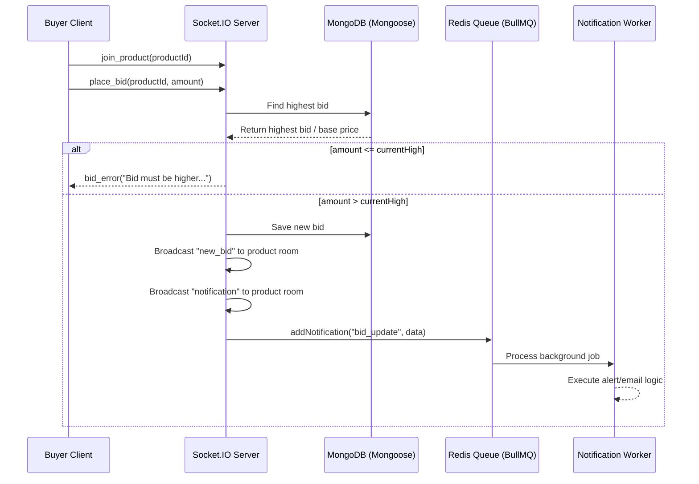
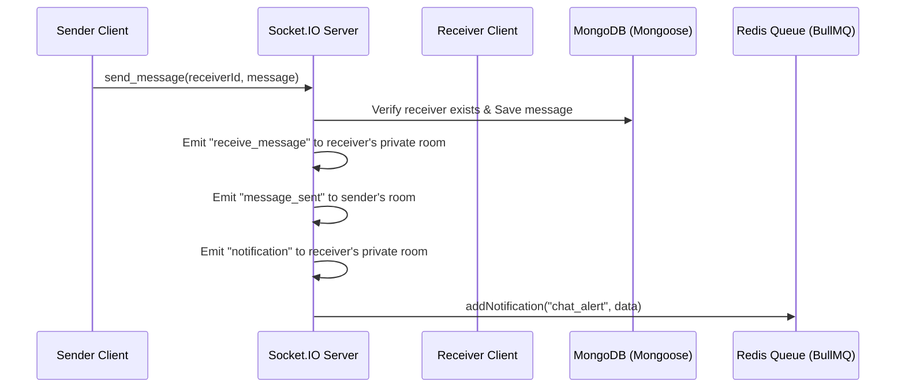
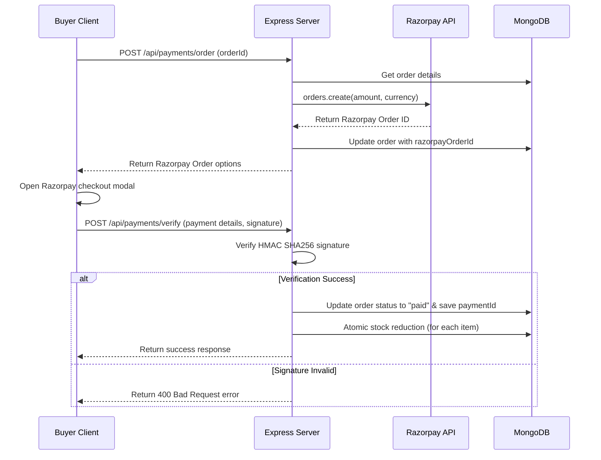

# 🧠 brain.md — Project Knowledge Base

This file serves as the complete, canonical knowledge base for the **Sustainable Local Marketplace** project. Always refer to this document before generating code, explanations, or plans.

---

## 1. Project Overview

### Problem Statement
Local sustainable producers (farmers, artisans, vendors) struggle to reach eco-conscious consumers directly, lacking a transparent platform to showcase their goods. At the same time, buyers struggle to:
- Discover verified local sustainable producers.
- Compare the environmental and sustainability impact of products.
- Trust product authenticity.
- Participate in secure, transparent, and interactive local commerce.

### Goals and Objectives
- **Direct Connection**: Cut out middlemen to connect local sustainable sellers and eco-conscious buyers directly.
- **Sustainability Transparency**: Introduce clear sustainability ratings (0-10) to make ecological impact a primary factor in purchasing decisions.
- **Engagement through Real-Time**: Leverage real-time features like WebSocket bidding/auctions and instant messaging to foster community trust.
- **Secure Transaction Loop**: Provide a robust payment checkout system backed by Razorpay.

### Target Users & Use Cases
- **Buyer**: Eco-conscious consumers who want to discover local produce, participate in live bidding/auctions for rare goods, track their orders, review products, and chat directly with sellers.
- **Seller**: Local farmers and artisans looking to manage their inventory, set up live bids, calculate sustainability scores, and fulfill client orders.
- **Admin**: System operators who monitor transactions, moderate listings, and manage system-wide activities.

### Unique Value Propositions
- **Premium Spatial UI**: High-fidelity glassmorphic design system matching Emerald & Sage palettes, animated blur blobs, custom SVGs, and interactive 3D WebGL leaf canvases.
- **Quantitative Sustainability Scoring**: Built-in metrics (0-10) directly integrated into the product detail schema.
- **Hybrid Real-Time Operations**: Double WebSocket channels (Socket.io) supporting direct client-to-seller messaging and real-time live bidding auctions.

---

## 2. Architecture Decisions

### Tech Stack Choices

| Layer | Technology | Justification |
|---|---|---|
| **Frontend Core** | React (Vite) | Faster bundler speeds, light overhead, and highly optimized build sizes compared to traditional bundlers. |
| **Frontend State** | Zustand | Simplistic, boilerplate-free global client states for authentication, notifications, and cart. |
| **Server State Sync**| TanStack React Query | Native declarative API endpoints polling, cache invalidations, and automatic sync. |
| **WebGL Layer** | Three.js (Raw canvas) | GPU-accelerated 3D effects (homepage leaf particles, interactive buttons) to match premium visual constraints. |
| **Styling** | Tailwind CSS v4 | Flexible, rapid design token declarations and dark-mode hooks. |
| **Backend API** | Node.js (Express) | Asynchronous, single-language stack (JavaScript/ESM), lightweight routing structure. |
| **Database** | MongoDB (Mongoose) | Flexible schema design fits varied product parameters (sustainability metrics) and nested review arrays. |
| **Cache & Pub/Sub** | Redis (ioredis) | Ultra-fast GET route caching with time-to-live (TTL), and acts as Socket.io adapter to support multi-server scaling. |
| **Job Queue** | BullMQ | Redis-backed background worker queue ensuring durable notification offloading and email tasks. |
| **Payments** | Razorpay | Fully-featured Indian localized payment gateway for UPI, Card, and Netbanking. |

### Architectural Trade-offs
- **MongoDB vs. SQL**: MongoDB was chosen for rapid prototyping. Schema variations in product categories (e.g. food ingredients vs. craft fabrics) are handled naturally through NoSQL. Type validations are enforced at the API boundary using **Zod** and at the database boundary via Mongoose.
- **Zustand vs. Redux**: Zustand provides a clean hook-based API without dispatch boilerplates, saving context budget and keeping stores modular (e.g., `authStore`, `cartStore`, `notificationStore`).
- **Redis Fail-Soft Fallbacks**: During development, if Redis is offline, the backend degrades gracefully to an in-memory socket adapter and skips BullMQ job creation without crashing the Node engine.

### Deployment Strategy
- **Development**: Started concurrently via `npm run dev` at the workspace root, initializing the backend on port 5000 and the frontend on port 5173.
- **Containerization**: The backend is containerized via a production-grade `Dockerfile` and `docker-compose.yml` supporting Redis container attachments.
- **Cloud Hosting**: Frontend hosted on Vercel/Netlify; Backend deployed on Render/AWS; MongoDB hosted on Atlas; Redis managed via Upstash (supporting secure TLS links).

---

## 3. System Flows

### User Auth & Role-Based Access Control (RBAC)
1. **Sign-up & Login**: Password hashing performed via `bcrypt`. Backend issues JWT tokens.
2. **Global Client State**: Zustand `authStore` catches token and user profile, persisting details in local storage.
3. **Route Guards**:
   - `GuestRoute.jsx` blocks logged-in users from revisiting `/login` or `/register`.
   - `ProtectedRoute.jsx` redirects unauthenticated traffic to `/login` (applied to `/cart`, `/checkout`, `/my-orders`, `/dashboard`, `/admin`).
   - `DashboardLayout.jsx` checks `user?.role === 'seller'` before loading seller widgets.
   - `AdminLayout.jsx` checks `user?.role === 'admin'` before launching administrative paths.

### Data Flow: Real-Time Bidding (Socket.io)


### Data Flow: Real-Time Chat (Socket.io)


### Data Flow: Razorpay Payment Loop


### Error Handling & Edge Cases
- **Rate Limit Lock-Outs**: The app runs a global rate limiter (100 reqs / 15 minutes) and a specialized Auth rate limiter. In production, auth is capped at 5 attempts per hour; in development, it is relaxed to 50 attempts per 15 minutes to ease testing.
- **Graceful Redis Degradation**: If Redis connection fails, Express caching skips redis storage and queries the DB directly, Socket.io switches to standard Memory sockets, and background job creators skip worker queues.

---

## 4. Features & Modules

### Module Map & Dependencies
```
        [Auth (RBAC)]
              │
      ┌───────┼───────┐
      ▼       ▼       ▼
  [Product] [Cart] [Chat]
      │       │       │
      ├───────┴───┐   │
      ▼           ▼   ▼
  [Review]      [Order] (Razorpay)
                  │
                  ▼
              [Queue] (BullMQ Notifications)
```

### Feature Checklist

- **Authentication & RBAC**
  - [x] Password hashing with `bcrypt`
  - [x] JWT Token issue & validation middleware
  - [x] Guarded guest & protected router groups
  - [x] Role check validation for Sellers and Admins
- **Product & Sustainability**
  - [x] Products management (Create, Read, Update, Delete)
  - [x] Categories filters and text search matching
  - [x] Product detail cards with sustainability score (0-10)
  - [x] Average rating computation from reviews
- **Cart & Order Checkout**
  - [x] Cart store with local persistent sync
  - [x] Checkout forms and order calculation
  - [x] Order tracking page `/my-orders` for buyers
- **Razorpay Payments**
  - [x] Order generation via Razorpay API
  - [x] SHA256 HMAC payment signature verification
  - [x] Atomic inventory stock reduction upon payment completion
- **Real-Time Features**
  - [x] Direct peer-to-peer Socket chat with typing indicators
  - [x] Live auction rooms and dynamic bidding
  - [x] Global websocket notifications header drawer
- **Background Jobs & Cache**
  - [x] Redis-based GET route caching and invalidations on updates
  - [x] BullMQ asynchronous workers handling order/bid alerts
- **Premium UI & Dark Theme**
  - [x] Asymmetric bento grid layouts on Homepage
  - [x] WebGL Three.js particle canvas (leaf drift system with rotation sines)
  - [x] Light border refractions and wandering GPU blurs
  - [x] Emoji cleanup — complete conversion to consistent inline stroke-width SVGs
  - [x] Sync dark theme toggle support using LocalStorage and device defaults

### UI/UX Rules
- **Color Palette**: Emerald/Sage green theme. Deep forest green highlights combined with clean slate/zinc variables.
- **Glassmorphism Spec**: Frosted panels, background filter blur of `12px`, borders using semi-transparent white:
  ```css
  background: rgba(255, 255, 255, 0.05);
  backdrop-filter: blur(12px);
  border: 1px solid rgba(255, 255, 255, 0.1);
  ```
- **SVG Standardization**: Do not use raw emojis in templates. Replace all icons with customizable inline SVGs.
- **Animation Hygiene**: Keep 3D Three.js frame renderers responsive, throttled to refresh parameters, and cleanly disposed of on component unmounting to prevent memory leaks.

---

## 5. Development Roadmap & Milestones

### Build Roadmap

```
Phase 1: Core REST APIs (Auth, Products, Reviews)
  └── Phase 2: Checkout & Local Payments (Orders, Razorpay Gateway)
        └── Phase 3: Real-Time Sockets (Chat, Auction Rooms)
              └── Phase 4: Job Queues & Cache (Redis, BullMQ Notification Workers)
                    └── Phase 5: Client SPA & Styling (React UI, Glassmorphism Facelift, Three.js)
```

### Verification & Testing Strategy
All core features are verified through standalone and automated scripts situated in `backend/tests/`:

1. **Auth Test Suite (`run-tests.js`)**: Matches sign-up, logins, duplicate entries, invalid formatting, and wrong credentials using an in-memory Mongo test database.
2. **Product Test Suite (`product-tests.js`)**: Validates product creations, permissions (sellers vs buyers), category listings, updates, and deletes.
3. **Review Test Suite (`review-tests.js`)**: Tests review postings, ratings constraint bounds, and average rating updates on target products.
4. **Socket Test Suite (`socket-tests.js`)**: Simulates concurrent client logins, room actions, bid updates, and real-time chat deliveries.
5. **REST API Files**: HTTP templates (`auth.test.http`, `product.test.http`) supporting manual execution tests.

### Debugging Notes & Historical Fixes
- **Redis Crash loops**: BullMQ queue connection retries were causing server crashes if Redis was offline. Configured `lazyConnect: true` and added explicit event listeners to skip queues gracefully.
- **Socket IO Redis Adapter Crash**: Duplicated client triggers crashed Node. Resolved by attaching error catch handlers to Redis pub/sub nodes and detecting `.status === 'ready'` before running `io.adapter()`.
- **Limiter lockout**: High-frequency testing led to API timeouts due to 5 reqs/hour limits on logins. Increased bounds to 50 reqs/15 minutes in development.
- **Protected Cart Routing**: Fixed a security loophole where the shopping cart was accessible to unauthenticated guests. Relocated `/cart` inside the `ProtectedRoute` node in `Router.jsx`.
- **Invalid API Pathing**: HomePage fetched from a generic object instead of `PRODUCTS.GET_ALL`. Corrected route endpoint mapping.

---

## 6. Documentation Rules
- **Decisions Log**: Every architectural revision or configuration adjustment must be recorded in this file.
- **Format Integrity**: Use structured Markdown, Mermaid flowcharts, and clear comparison tables.
- **Empirical Validation**: When a feature gets updated, run backend tests and compile production builds (`npm run build`) to guarantee correctness.

---

## 7. Completion Checklist
- [x] Core models, schemas, and validators implemented.
- [x] Payment loops and inventory deductions active.
- [x] WebSocket messaging and bidding rooms verified.
- [x] Background worker tasks resilient to offline queues.
- [x] SPA client components updated with premium glassmorphism.
- [x] Dark mode syncing active across navbar settings.
- [x] Emojis replaced with consistent stroke SVGs.
- [x] Production frontend builds compiled with zero error messages.
- [x] Knowledge base documentation consolidated.
